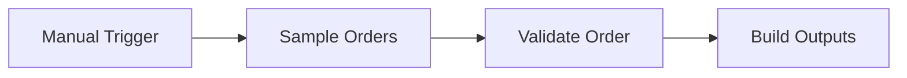

# Order Processing

Simulation of a common client request type. All data is synthetic, and external services are mocked. Executed in an isolated n8n 2.41.7 instance; evidence is in `evidence/`.

## Business problem

New orders need consistent validation, a total for record keeping, and a notification for the operations team. Incomplete orders need an actionable error report.

## Solution

The workflow validates sample orders, calculates EUR totals using integer cents, and builds a spreadsheet row and email notification payload for valid orders. Invalid orders produce an error payload. These outputs remain workflow data; nothing is written to a spreadsheet or sent by email.

**Nodes used:** Manual Trigger (`n8n-nodes-base.manualTrigger`), Code (`n8n-nodes-base.code`).

## Flow



Validation and error formatting happen inside the Code nodes; there is no separate error branch.

## Data contract

- Input: `order_id`, `created_at`, `customer_name`, `customer_email`, and `items` containing `sku`, `qty`, and `unit_price_cents`.
- The order fields must be non-empty strings, the email must match the implemented email pattern, and `items` must be a non-empty array. Quantities must be positive integers; unit prices must be non-negative integers.
- Validation preserves the input and adds `valid` and `reasons`.
- Valid output: `sheet_row` containing the order fields, `items_count` (line count), `total_cents`, and `total_eur` (a decimal string); `notification` containing `to`, `subject`, and `body`.
- Invalid output: `error` containing `order_id` and `reasons`.

## Error handling

Validation collects all detected issues rather than stopping at the first. An empty email produces both missing and invalid email reasons. Invalid orders receive only an error payload, without a spreadsheet row or notification.

## How to run the tests

From this case-study folder:

```bash
python3 -m unittest discover -s tests
```

The tests use only the standard library and run offline. They inspect workflow structure and JavaScript text, and compare a Python reference implementation against expected validation, output, and integer-cent formatting results. They do not execute JavaScript or n8n.

## How to import into n8n

Use **Workflows > Import from File > workflow.json**. The workflow has a Manual Trigger, inline mock data, no credentials, and is inactive. Run it manually to inspect the output payloads.

## Execution evidence

[execution-output.json](evidence/execution-output.json) records a valid output for `A-1001`: 2 line items, `total_cents: 3000`, and `total_eur: "30.00"`. `B-1002` produces 3 reasons: missing email, invalid email, and a non-positive quantity. Provenance is in [SOURCE.md](evidence/SOURCE.md).

## Known limitations

- Fixed sample input and a fixed notification recipient; no order intake, spreadsheet integration, or email delivery.
- EUR only; no tax, shipping, or discounts.
- `created_at` is checked only for a non-empty string; `sku` is not validated.
- No persistent duplicate protection or safe-integer bound on calculated totals.

## What changes for production

Replace the sample source with an order API or webhook, configure real service credentials, and connect the output payloads to spreadsheet and email nodes. Add timestamp and SKU validation, supported pricing rules, persistent order deduplication, amount bounds, retries, and failure alerts.
