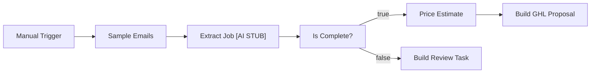

# Drywall Estimate

Simulation of a common client request type. All data is synthetic, and external services are mocked. Executed in an isolated n8n 2.41.7 instance; evidence is in `evidence/`.

## Business problem

Email quote requests often contain enough information to draft an estimate, while incomplete requests need review before pricing.

## Solution

The workflow extracts wall area, ceiling area, board type, and finish level from sample email bodies using deterministic regular expressions. Complete requests receive a mock GoHighLevel proposal payload with placeholder USD pricing. Incomplete requests receive a review-task payload. Neither payload is sent to an external service.

**Nodes used:** Manual Trigger (`n8n-nodes-base.manualTrigger`), Code (`n8n-nodes-base.code`), If (`n8n-nodes-base.if`).

## Flow



## Data contract

- Input email: `id`, `from`, `subject`, and `body`.
- Extracted job: `id`, `from`, `subject`, `walls_sqft`, `ceiling_sqft`, `board` (`standard` or `moisture`), `finish_level` (3, 4, or 5), `missing`, and `complete`.
- Pricing adds `area_sqft`, `sheets`, `board_cents_per_sheet`, `labor_cents_per_sqft`, `materials_cents`, `labor_cents`, `ceiling_surcharge_cents`, `subtotal_cents`, `margin_cents`, and `total_cents`. Sheet quantities allow 10% waste; margin is 20% of subtotal, rounded half up in cents.
- Complete output: `ghl_proposal.contact.email` and `ghl_proposal.estimate` containing `name`, `currency`, `line_items`, `total_cents`, and `total_usd`. Each line item has `name`, `qty`, and `unit_price_cents`.
- Incomplete output: `review_task` containing `email_id`, `from`, `subject`, `missing`, `title`, and `note`.

## Error handling

Unrecognized job fields become `null` and enter `missing`. The If node sends incomplete jobs to review without pricing. This handles missing extraction fields; malformed email objects have no dedicated error branch.

## How to run the tests

From this case-study folder:

```bash
python3 -m unittest discover -s tests
```

The standard-library tests run offline. They inspect nodes, connections, branch settings, and JavaScript text, and compare a Python reference implementation against expected extraction, pricing, proposal, review, and rounding results. They do not execute JavaScript or n8n.

## How to import into n8n

Use **Workflows > Import from File > workflow.json**. The workflow has a Manual Trigger, inline mock data, no credentials, and is inactive. Run it manually to inspect both output branches.

## Execution evidence

[execution-output.json](evidence/execution-output.json) records 2 proposals: `E1` totals 463800 cents (`4638.00` USD) with 55 sheets, and `E2` totals 145680 cents (`1456.80` USD) with 14 sheets. `E3` produces 1 review task for missing wall area, ceiling area, and board type. Provenance is in [SOURCE.md](evidence/SOURCE.md).

## Known limitations

- Fixed sample emails and narrow regex extraction; the AI stub makes no AI call.
- Placeholder rates and simplified area pricing; zero area is accepted.
- No sender validation or general input-schema validation.
- The GoHighLevel payload is a mock shape; no API submission, PDF generation, or email delivery.

## What changes for production

Connect a real inbox with service credentials, replace the extraction stub with validated structured extraction, and confirm pricing and measurement rules. Implement the actual GoHighLevel API mapping, PDF generation, and review delivery. Add schema checks, duplicate protection, retries, and failure alerts before enabling automated runs.
