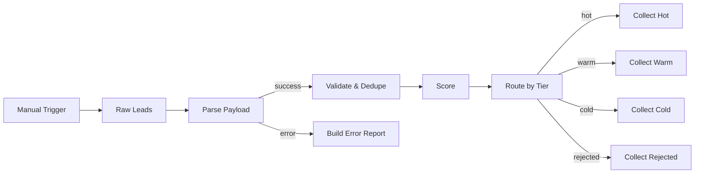

# Lead Router

Simulation of a common client request type. All data is synthetic, and external services are mocked. Executed in an isolated n8n 2.41.7 instance; evidence is in `evidence/`.

## Business problem

Incoming leads need consistent validation, duplicate filtering, and prioritization before they reach a sales queue.

## Solution

The workflow parses sample JSON payloads, trims and lowercases email addresses, keeps the first valid normalized email within the run, and scores accepted leads. A Switch routes hot, warm, cold, and rejected leads to summary collectors. Parsing failures produce a separate error report.

**Nodes used:** Manual Trigger (`n8n-nodes-base.manualTrigger`), Code (`n8n-nodes-base.code`), Switch (`n8n-nodes-base.switch`).

## Flow



## Data contract

- Input: `lead_id` and `raw`, a JSON string containing `name`, `email`, `budget`, and `source`.
- Validation returns those parsed fields with normalized `email`, `valid`, and `reason` (`null`, `invalid_email`, or `duplicate`).
- Accepted leads gain `budget_points`, `source_points`, `score`, and `tier`. The `budget` field gives 50 points at or above 5000, 30 at or above 2000, otherwise 10. Sources give 30 for `referral`, 10 for `web`, otherwise 0. Tiers are hot at score >= 60, warm at >= 30, otherwise cold.
- Rejected leads receive `tier: "rejected"` and `score: 0`.
- Collector output: `tier`, `count`, and `leads`. Accepted summaries contain `lead_id`, `email`, and `score`; rejected summaries contain `lead_id`, `email`, and `reason`.
- Parse-error output: `lead_id`, `stage: "parse"`, `reason: "invalid_json"`, `error`, and `raw`.

## Error handling

Parse Payload uses its error output to retain the failing input and build a report while valid items continue. Invalid email addresses and duplicates follow the rejected Switch branch. The first valid normalized email wins; invalid addresses are not added to the deduplication set.

## How to run the tests

From this case-study folder:

```bash
python3 -m unittest discover -s tests
```

The standard-library tests run offline. They inspect the workflow, error output, Switch rules, and JavaScript text, and compare a Python reference implementation against expected parsing, normalization, deduplication, scoring, and collection results. They do not execute JavaScript or n8n.

## How to import into n8n

Use **Workflows > Import from File > workflow.json**. The workflow has a Manual Trigger, inline mock data, no credentials, and is inactive. Run it manually to inspect the collectors and parse-error report.

## Execution evidence

[execution-output.json](evidence/execution-output.json) records 2 hot leads (`L1` and `L6`, score 60 each), 1 cold lead (`L2`, score 10), and 2 rejected leads (`L3` duplicate and `L4` invalid email). `L5` produces 1 parse-error report. There are no warm leads; `Collect Warm` is `null` because that branch did not run. Provenance is in [SOURCE.md](evidence/SOURCE.md).

## Known limitations

- Deduplication applies only within a run; no persistent lead history.
- Fixed samples and scoring rules; no CRM or spreadsheet writes.
- Validation checks email, without a complete payload schema or numeric type checks.
- A `lead_id` inside the parsed payload can override the outer identifier.
- Empty branches do not emit a collector summary.

## What changes for production

Replace the sample source with authenticated lead intake and configure real CRM or spreadsheet credentials. Validate the complete payload, preserve the intake identifier, store deduplication keys, and agree on scoring rules. Replace collectors with destination writes and add retries, failure alerts, and rejected-lead review.
