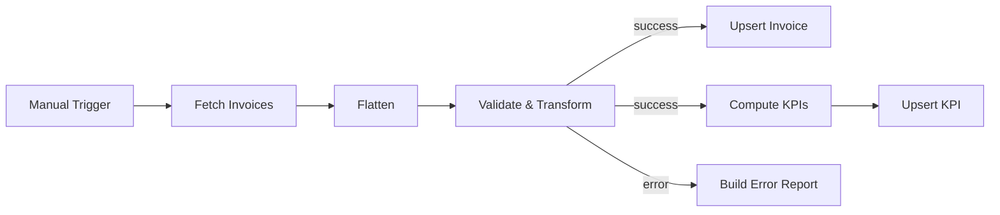

# Jobber to Supabase Weekly KPIs

Simulation of a common client request type. All data is synthetic, and external services are mocked. Executed in an isolated n8n 2.41.7 instance; evidence is in `evidence/`.

## Business problem

Invoice data needs a repeatable reporting pipeline that separates invalid records and summarizes paid revenue and invoice counts by week.

## Solution

The workflow fetches paginated invoices from a local Jobber mock, validates totals, converts them to integer cents, and assigns UTC ISO weeks. Valid invoices feed both invoice upserts and weekly KPI calculation, followed by KPI upserts to a local Supabase mock. Stable conflict keys and `Prefer: resolution=merge-duplicates` make repeated writes replace existing rows.

**Nodes used:** Manual Trigger (`n8n-nodes-base.manualTrigger`), HTTP Request (`n8n-nodes-base.httpRequest`), Code (`n8n-nodes-base.code`).

## Flow



## Data contract

- API input: `data.invoices.nodes` and `data.invoices.pageInfo` containing `hasNextPage` and `endCursor`. Invoice fields: `id`, `client`, `status`, `total`, and `issuedAt`.
- `total` must be a non-negative decimal string with exactly two fractional digits, matching `^\d+\.\d{2}$` without extra characters, and fit within JavaScript's safe-integer range after conversion to cents. `issuedAt` is expected as `YYYY-MM-DD`.
- Invoice row: `id`, `client`, `status`, `total_cents`, `issued_at`, and `iso_week` (`YYYY-Www`). Upserts use `on_conflict=id`.
- KPI row: `iso_week`, `revenue_paid_cents`, `invoices_paid`, `invoices_open`, and `avg_paid_cents`. Only exact status `paid` contributes revenue and paid counts. Average is floored paid revenue divided by paid count, or 0 when none are paid. Upserts use `on_conflict=iso_week`.
- Validation-error output: `id` and `reason`, derived from the actual error message.

## Error handling

Invalid totals raise `invalid_total`; dates that cannot be parsed raise `invalid_issued_at`. The validation error output goes to Build Error Report and skips both success branches. Fetch and both upserts allow 3 attempts with 1000 ms between attempts; transport failures stop execution after retries.

The mock returns HTTP 429 on the first request for cursor `c2`. A node-level retry restarts the whole Fetch Invoices node from `after: null`: `null, c2 → 429, null, c2, c3` (5 calls in a fresh mock process). The offline tests also model a separate page-level retry; that is not the workflow's configured retry behavior.

## How to run the tests

From this case-study folder:

```bash
python3 -m unittest discover -s tests
```

The standard-library tests run offline without starting the mock server. They inspect workflow structure, pagination, retries, error routing, and request projections, and compare a Python reference implementation against expected invoice and KPI rows. They also check mock request logs, repeated upserts, decimal boundaries, and ISO week-year boundaries. They do not execute JavaScript or n8n; the Python date parser is stricter than JavaScript's date parser.

## How to import into n8n

From this case-study folder, start the local mock API first:

```bash
python3 -s -B mock/mock_jobber_supabase.py --port 5690 --log mock-api-log.jsonl
```

The mock binds to `127.0.0.1:5690`; `--log` is required and records requests as JSON lines. Keep it running while executing the workflow. n8n must reach this same loopback address; a separate container's loopback does not point to the host mock.

Use **Workflows > Import from File > workflow.json**. The workflow has a Manual Trigger, no credentials, and is inactive. Inline mock invoice data lives in `mock/mock_jobber_supabase.py` and is served to its HTTP Request nodes. All workflow URLs use `http://127.0.0.1:5690`.

## Execution evidence

[execution-output.json](evidence/execution-output.json) records 4 stored invoices and 2 weekly KPI rows, with identical state after both recorded runs. `INV-4` produces the reason `invalid_total [line 4]`.

| ISO week | Paid revenue (cents) | Paid invoices | Open invoices | Average paid (cents) |
| --- | --- | --- | --- | --- |
| 2026-W41 | 165050 | 2 | 1 | 82525 |
| 2026-W42 | 99999 | 1 | 0 | 99999 |

Provenance and the repeated-run comparison are described in [SOURCE.md](evidence/SOURCE.md).

## Known limitations

- Every non-paid status counts as open (`invoices_open`), including draft or void statuses.
- No calendar round-trip date check; JavaScript can normalize impossible calendar dates.
- No real OAuth/credentials; the GraphQL request and database endpoints use mock contracts.
- No dashboard or scheduled trigger.
- Pagination is capped at 10 requests per attempt; the workflow does not flag an incomplete reporting window at the cap.
- Weekly upserts replace totals, so a partial reporting window can overwrite complete totals.
- Mock tables are in memory and disappear when the mock process stops; repeatability covers identical inputs, not deletion reconciliation.
- Identifier and status validation, aggregate safe-integer checks, and atomic writes across both branches are absent.

## What changes for production

Configure Jobber OAuth and real Supabase credentials in n8n. Map the actual GraphQL schema and cursor into `variables.after`, replace the mock URLs, and create unique conflict keys. Add a Schedule trigger, fetch complete reporting windows, validate calendar dates and statuses, and enforce amount bounds. Add reconciliation, coordinated write recovery, pagination-completeness checks, suitable retry backoff, failure alerts, and a reporting dashboard.
