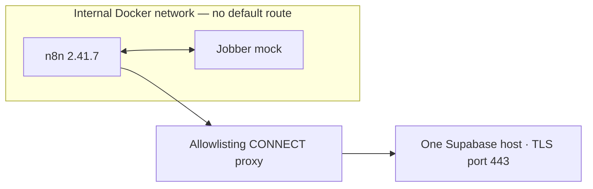

# Jobber to Supabase — live write

Simulation of a common client request type. All data is synthetic and Jobber is mocked; the Supabase writes went to a real, temporary Supabase project that was deleted after the test. Executed in an isolated n8n 2.41.7 instance whose only network path was an allowlisting proxy to that one Supabase host; evidence is in `evidence/`.

## Business problem

Invoice reporting needs repeatable database writes, weekly totals, and a visible record of rejected rows. This project tests whether those writes remain stable across repeated runs and whether a database constraint failure leaves the stored invoices intact.

## Architecture

The workflow fetches paginated invoices from a local Jobber mock, validates and transforms them into integer cents and UTC ISO weeks, then sends invoice and weekly KPI upserts to Supabase. Validation failures and invoice upsert failures have separate error reports. `base-workflow.json` preserves the local mock version from which `workflow.json` was derived.



n8n shares the mock container's network namespace, reaching Jobber on loopback. Only the proxy also connects to the external Docker network. The workflow uses Manual Trigger, HTTP Request, and Code nodes.

## Security design

- Single-host egress permits CONNECT tunnels only to the configured Supabase host on port 443. The internal network has no default route and no direct internet access.
- Supabase uses a publishable key and Row Level Security; see [sql/schema.sql](sql/schema.sql). These test policies allow the anonymous role to select, insert, and update synthetic rows; they do not provide tenant isolation.
- The credential is injected from a file outside Git into a temporary directory, mounted read-only for import into n8n, and the directory is deleted after each run.
- Every output is scanned for credential leaks. All five receipts record `leak_check: PASS` and `secret_dir_removed: true`; the key never appears in logs. Proxy logs contain tunnel metadata, not decrypted payloads.
- Runtime images are pinned by digest. Digests, source hashes, sanitization details, and independent read-back provenance are in [evidence/SOURCE.md](evidence/SOURCE.md).

## Data contract

- Input: `data.invoices.nodes` plus `data.invoices.pageInfo.hasNextPage` and `endCursor`. Each invoice supplies `id`, `client`, `status`, `total`, and `issuedAt`.
- `total` must be a non-negative decimal string with exactly two fractional digits and fit JavaScript's safe-integer range after conversion to cents. `issuedAt` must match `YYYY-MM-DD`; the workflow derives a UTC ISO week.
- Invoice rows: `id`, `client`, `status`, `total_cents`, `issued_at`, and `iso_week`. Upserts use `on_conflict=id`. Postgres additionally requires `0 <= total_cents < 10000000`.
- Weekly rows: `iso_week`, `revenue_paid_cents`, `invoices_paid`, `invoices_open`, and `avg_paid_cents`. Exact status `paid` contributes paid revenue and count; `awaiting_payment` contributes open count. Average is floored paid revenue divided by paid count, or zero. Upserts use `on_conflict=iso_week` and `Prefer: resolution=merge-duplicates`.
- Validation reports contain `stage`, `id`, `total`, and `reason`. Invoice upsert reports contain `stage`, `id`, `status`, and `message`.

## Results

The four writes and five independent table read-backs were recorded on **2026-10-20 UTC**. Every run exited successfully, reported no credential leak, and removed its temporary credential directory. `INV-4` was excluded by validation with `invalid_total` in all four runs.

| Evidence | Observed result |
| --- | --- |
| [r0.json](evidence/r0.json) | Both tables empty before execution. |
| Run 1 / [r1.json](evidence/r1.json) | Wrote 4 invoices and 2 weekly KPI rows. W41: 165050 paid cents, 2 paid, 1 open, average 82525 cents. W42: 99999 paid cents, 1 paid, 0 open, average 99999 cents. |
| Run 2 / [r2.json](evidence/r2.json) | Idempotent: byte-identical to r1 by SHA-256. |
| Run 3 / [r3.json](evidence/r3.json) | `INV-6` (20000000 cents) rejected by the Postgres CHECK constraint: code `23514`, HTTP `400`. The 4 stored invoices and W41 stay unchanged. W42 still counts the rejected row: 20099999 paid cents, 2 paid, 0 open, average 10049999 cents. See the [upsert error report](evidence/run-3.build-upsert-error-report.json). |
| Run 4 / [r4.json](evidence/r4.json) | Restored r1 exactly, including its SHA-256. |
| Run egress | Runs 1, 2, 3, and 4 allowed 6, 6, 7, and 6 tunnels (CONNECTs), respectively, all to the single Supabase host; matching close counts and zero denied tunnels. |
| [Isolation probe](evidence/egress-probe.receipt.json), 2026-10-18 UTC | All checks matched expectations. No default route; Jobber loopback reachable; direct Supabase access timed out; direct public IP access failed with `ENETUNREACH`; external DNS timed out; all three host/gateway canary checks failed. Proxy denied tunnels to a different hostname and a public IP with `403`, and allowed the Supabase tunnel with `200` (1 allowed, 2 denied tunnels). Docker socket and host mounts were absent; root and input mounts were read-only; temporary storage was writable; execution used UID/GID 1000. |

`r1.json`, `r2.json`, and `r4.json` share SHA-256 `1b9816a5eea89cc33febf643ba9d5aa4f39a1521f6f7c6a400adea8453bb9e5d`. See [evidence/SUMMARY.md](evidence/SUMMARY.md) for the run receipts and read-back hashes.

## Known limitations

- KPI calculation branches from validated input before database acceptance. It counts the rejected `INV-6` row in run 3; invoice and KPI writes are not atomic.
- Jobber is mocked; no real Jobber OAuth or API integration was exercised.
- Proxy counts measure tunnels (CONNECTs), not HTTP operations within them.
- The free Supabase project was deleted after testing, so the live database is no longer reachable.
- The test RLS policies are permissive. Calendar dates are checked for shape, but JavaScript can normalize impossible dates; aggregate safe-integer checks are absent.
- Pagination is capped at 10 pages per attempt without an incomplete-window error. Weekly upserts replace totals, so partial input can overwrite complete totals; removed input rows are not reconciled.

## How to run the tests

From the repository root:

```bash
python3 -B -m unittest discover -s portfolio/12-jobber-supabase-live/tests -p 'test_*.py'
```

From this project folder:

```bash
python3 -B -m unittest discover -s tests -p 'test_*.py'
```

The standard-library tests run offline. They inspect workflow structure and error routing, exercise mock handlers without a server, and test proxy transport with local socketpairs while forbidding DNS and outbound connections. They do not execute n8n or JavaScript or reconnect to Supabase; the recorded executions are separate evidence.

## What changes for production

Configure real Jobber OAuth and map its GraphQL schema and pagination. Provision a new Supabase project, replace the retired host in the workflow and allowlist, and use managed credentials with restricted RLS policies. Preserve the egress boundary, output leak scanning, and credential cleanup.

Align validation with database constraints and calculate KPIs from accepted rows, or use a database transaction to coordinate invoice writes and aggregation. Add complete reporting windows, deletion reconciliation, strict date and status checks, bounded retries with backoff, scheduling, monitoring, and failure alerts.
