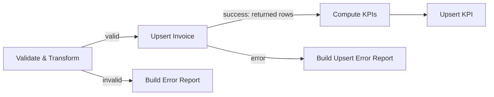

Follow-up to project 12. Proven in an isolated n8n 2.41.7 instance with no network access against a local mock that mirrors the Supabase CHECK constraint; it was not re-run against live Supabase, because the temporary project was deleted. Evidence is in `evidence/`.

## Problem

Project 12 calculated KPIs from validated input before database acceptance. Its run 3 therefore counted `INV-6` even though the database rejected that row.

## Fix

`Compute KPIs` receives only the `Upsert Invoice` success output: rows returned by the database. Rejected upserts go to `Build Upsert Error Report`; validation failures go to `Build Error Report`.



## Results

Both Jobber and Supabase were mocked, with synthetic data. The retained runs took place on 2026-10-22 UTC: default 11:44:26–11:44:44; partial 11:44:49–11:45:04. See [evidence provenance](evidence/SOURCE.md) and the [default](evidence/default.receipt.json) and [partial](evidence/partial.receipt.json) receipts.

| Result | Default fixture | Partial fixture |
| --- | --- | --- |
| Stored invoices | INV-1, INV-2, INV-3, INV-5 | INV-1, INV-2, INV-3, INV-5 |
| W41: revenue_paid_cents / invoices_paid / invoices_open / avg_paid_cents | 165050 / 2 / 1 / 82525 | 165050 / 2 / 1 / 82525 |
| W42: revenue_paid_cents / invoices_paid / invoices_open / avg_paid_cents | 99999 / 1 / 0 / 99999 | 99999 / 1 / 0 / 99999 |
| INV-6 upsert | Absent | 400, code `23514`, `invoices_total_cents_check`; total_cents 20000000 |
| Build Upsert Error Report | No items | Exactly 1 item: `{stage:"upsert", id:"INV-6", status:400}` |
| Build Error Report | 1 item: INV-4, invalid_total `"abc"` | 1 item: INV-4, invalid_total `"abc"` |
| Idempotent across 2 inner runs | Yes; invoices and KPIs identical | Yes; invoices and KPIs identical |
| Wrapper / inner n8n exits | 0 / 0, 0 | 0 / 0, 0 |

Each fixture's two inner runs shared one mock process. The mock injects a 429 once per process, so the Jobber request sequences were:

- Inner run 1: `null→200, c2→429, null→200, c2→200, c3→200` (one 429; retry restarts pagination).
- Inner run 2: `null→200, c2→200, c3→200` (no further 429).

## Known limitations

- This is mock-only proof; the fix was not re-run against live Supabase.
- If every invoice upsert fails, no KPI rows are written.
- Invoice and KPI writes are still not atomic.

## Run the tests

From the repository root:

```sh
python3 -B -m unittest discover -s portfolio/12-jobber-supabase-live/fix-accepted-rows/tests -p 'test_*.py'
```

From inside this folder:

```sh
python3 -B -m unittest discover -s tests -p 'test_*.py'
```
