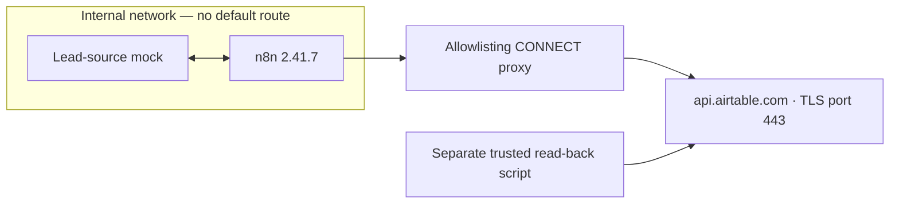

# Airtable lead CRM — live write

Simulation of a common client request type. All data is synthetic and the lead source is mocked; the CRM writes went to a real, temporary Airtable base that was deleted after the test. Executed in an isolated n8n 2.41.7 instance whose only network path was an allowlisting proxy to api.airtable.com; evidence is in `evidence/`.

## Business problem

Incoming leads need consistent parsing, email validation, duplicate handling, and scoring before they enter a CRM. Repeated imports should update existing leads by email, while malformed payloads, rejected leads, and database write failures remain visible in separate reports.

## Architecture

The workflow fetches synthetic leads from a local lead-source mock, normalizes and scores them, then upserts accepted leads into Airtable. A separate trusted read-back script checks the stored records independently of n8n. `base-workflow.json` is the local-mock version from which `workflow.json` was derived.



The read-back script runs separately from the isolated n8n instance. The workflow's only external network path is the egress proxy.

## Flow

Fetch Leads → Split Leads → Parse Payload → Validate & Dedupe → Score → Accept or Reject → Upsert Lead → Summarize CRM.

- Parse Payload sends invalid JSON to Build Error Report.
- Accept or Reject sends duplicate or invalid leads to Collect Rejected.
- Upsert Lead sends successful response representations to Summarize CRM and failures to Build Upsert Error Report.

Upsert Lead uses `PATCH` with `performUpsert.fieldsToMergeOn` set to `["Email"]`, one record per request, and no `typecast`. It enables `retryOnFail`, with 3 tries and 1000 ms between tries. Summarize CRM counts created and updated record IDs and tiers from successful responses.

## Security design

- Single-host egress permits only `api.airtable.com:443` through the allowlisting proxy. The internal network has no default route.
- A Personal Access Token is scoped to reading and writing records in one base.
- The credential is injected from a file outside Git into a temporary directory, which is deleted after each run.
- Every output is scanned for leaks, including the value of the `Authorization: Bearer` header. All three receipts record `leak_check: PASS` and `secret_dir_removed: true`; the token never appears in logs or evidence.
- Runtime images are pinned by digest. Source hashes, sanitization, and independent read-back provenance are documented in [evidence/SOURCE.md](evidence/SOURCE.md).

## Airtable table schema

| Field | Type and purpose |
| --- | --- |
| Email | Single line text; merge key |
| Lead ID | Text |
| Name | Text |
| Budget | Integer |
| Source | Single select: `referral`, `web`, `ads` |
| Score | Integer |
| Tier | Single select: `hot`, `warm`, `cold` |

## Results

Three real Airtable runs and four independent read-backs were recorded on **2026-10-24 UTC**. See [evidence/SUMMARY.md](evidence/SUMMARY.md) and the individual JSON files.

| Evidence | Observed result |
| --- | --- |
| [r0.json](evidence/r0.json) | Empty before execution: `{"leads": []}`. |
| Run 1 / [r1.json](evidence/r1.json) | Created 3 leads: L1 Ana (hot), L2 Ben (cold), L6 Dee (hot). Summarize CRM reported created 3 / updated 0; tiers hot 2 / cold 1. |
| Run 2 / [r2.json](evidence/r2.json) | Idempotent: identical SHA-256 to r1. Summarize CRM reported created 0 / updated 3. |
| Run 3, partial fixture / [r3.json](evidence/r3.json) | Airtable rejected L7 (`eve@example.com`) with HTTP 422, `INVALID_MULTIPLE_CHOICE_OPTIONS`, for the unsupported Source option `fax`; see the [report items](evidence/run-3.n8n-report-items.json). r3 has the same SHA-256 as r1. Summarize CRM reported created 0 / updated 3. |
| Every run: parsing and validation | Build Error Report contains L5 (invalid JSON). Collect Rejected contains L3 (duplicate) and L4 (invalid email). |
| Egress | Only `api.airtable.com:443`: 3 / 3 / 4 allowed tunnels in runs 1 / 2 / 3, with matching close counts. Run 3 processed one additional lead (L7); the proxy records tunnels, not which request used which tunnel. |
| Credential handling | Leak check PASS and temporary credential directory removed in every run. |

`r1.json`, `r2.json`, and `r3.json` share SHA-256 `db9cda810b80b402ba51241117128f045f887a6c7226cad052d9870f4e6eab37`. The three stored records remain unchanged after the partial fixture's write failure.

## Known limitations

- The lead source is mocked; a real source integration was not exercised.
- Writes use one request per lead, without batching up to 10 records.
- Retry configuration is 3 tries with 1 second between tries; there is no long back-off for HTTP 429 responses.
- Writes are not transactional. A failure mid-run leaves earlier records written.
- The temporary base was deleted after testing and is no longer reachable.
- Proxy counts measure tunnels (HTTP CONNECTs), not HTTP requests within them.

## How to run the tests

In the public repository layout, this project folder sits at the repository root. From that root:

```bash
python3 -B -m unittest discover -s 13-airtable-lead-crm/tests -p 'test_*.py'
```

From this project folder:

```bash
python3 -B -m unittest discover -s tests -p 'test_*.py'
```

The tests use only the Python standard library and run offline with no network. They inspect workflow structure, field mapping, retry configuration, error routes, and the Airtable allowlist; exercise parsing, scoring, deduplication, mock upserts, and idempotency through a Python reference model; and check read-back pagination, credential-file validation, and output leak rejection with fake responses. They do not execute JavaScript or n8n or reconnect to Airtable. `tests/reference/` holds helper copies from projects 10 and 12, with only their Python path expressions adjusted for this layout.

## What changes for production

Connect a real lead source and provision a new Airtable base with the schema managed as code. Batch up to 10 records per write, add HTTP 429 back-off, and define recovery for partial writes. Use a secret store, rotate the narrowly scoped token, and retain the egress boundary, output leak scanning, and credential cleanup. Add scheduling, monitoring, and alerts for rejected leads and write failures.
